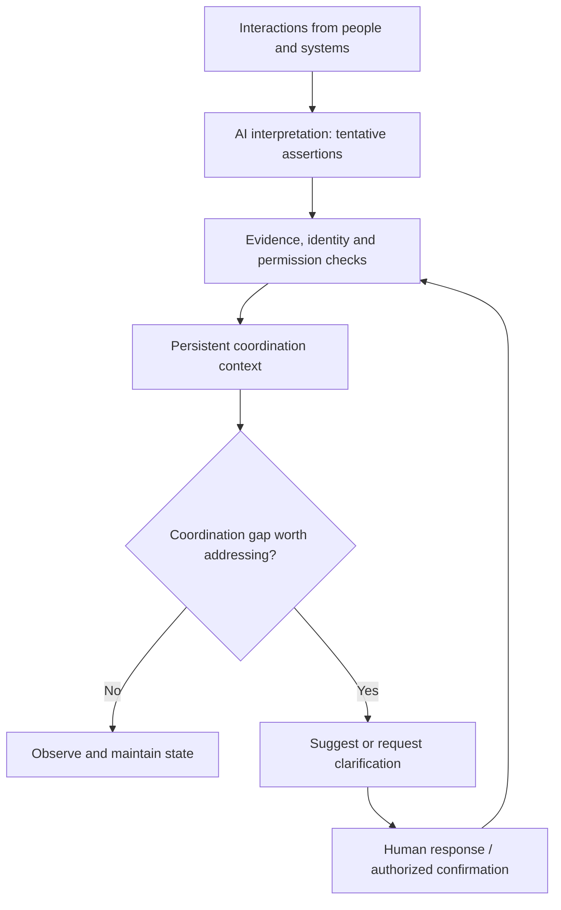
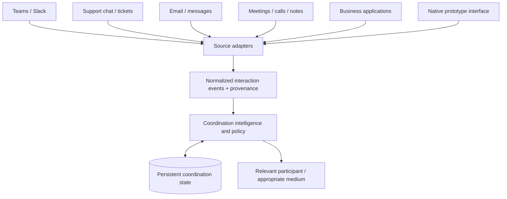
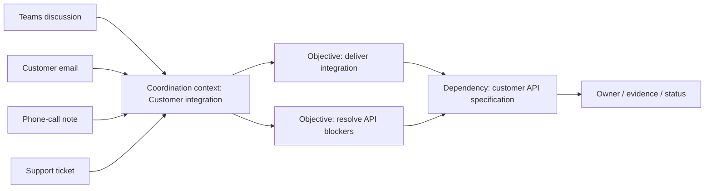
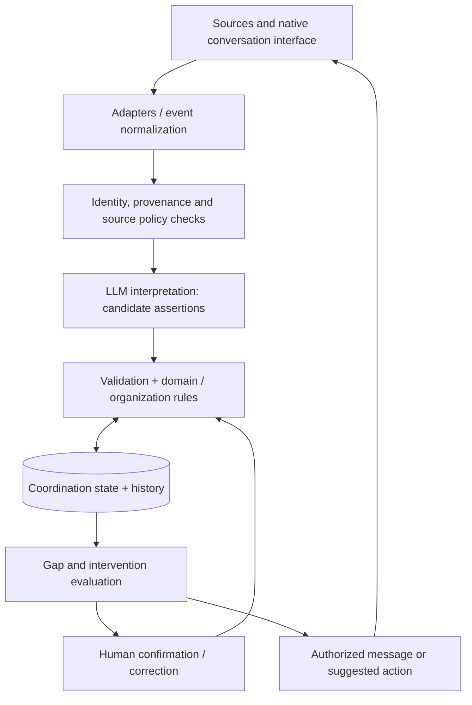

# CoordinationAI — AI-Powered Human Coordination

> **Status:** Product concept / research prototype  
> **Working name:** CoordinationAI (working name; final branding not selected)  
> **Scope:** Product concept only. The separate initiative to learn AI-enabled software development is not covered here.

## 1. Executive summary

**What if AI helped people coordinate, not just communicate?**

People discuss work in collaboration channels, support chats, emails, calls, meetings, documents, and business applications. But conversations alone do not ensure that the right people share the right information, accept responsibilities, make valid decisions, resolve dependencies, and follow through.

**CoordinationAI** is a proposed **communication-independent AI coordination system**. It interprets available human interactions, maintains an explicit and persistent representation of coordination, detects gaps and contradictions, and selectively helps participants clarify, decide, and act. It operates **in the background by default**, stepping into conversations only when useful and permitted. Humans remain responsible for consequential commitments, approvals, and actions.

The goal is not to replace Teams, Slack, Zendesk, ticketing tools, or project trackers. The goal is to connect coordination across them—and across information that participants supply manually when a conversation is unavailable to the system.

**Central hypothesis:** A persistent, role-aware, evidence-backed coordination state, combined with selective AI interventions, can improve multi-party coordination over conversations and summaries alone. This is a hypothesis to test, not an established advantage or market claim.

## 2. The underlying problem

Communication happens continuously, while coordination is often implicit:

- **Fragmented context:** Related information lives in different conversations and tools.
- **Unclear responsibility:** A proposed owner is mistaken for someone who accepted the work.
- **Decision ambiguity:** A suggestion or casual agreement is treated as final approval.
- **Invisible dependencies:** People do not know what blocks progress or who can unblock it.
- **Weak continuity:** Context disappears when conversations end, people change, or work moves to another medium.
- **Asymmetric visibility:** Internal and external participants need different information about the same objective.
- **Unverified updates:** Secondhand reports and AI inferences can be mistaken for authoritative facts.

**A conversation is an information source; it is not the unit or boundary of coordination.**

## 3. Example: from conversation to coordination

**Alice:** “We should release the new version on Friday.”  
**Bob:** “I can handle deployment, but Charlie needs to approve the security changes.”  
**Charlie:** “I haven't reviewed them yet.”

A summary may list the discussion. A coordination engine represents what is **known, proposed, and unresolved**:

| Item | Coordination interpretation |
|---|---|
| Possible objective | Release the new version Friday (proposed, not finalized) |
| Deployment owner | Bob has expressed willingness; verify acceptance and scope |
| Dependency | Security change review and approval |
| Approver | Charlie is named as an intended approver; actual authority must be verified |
| Decision | No authorized release decision established |
| Next clarification | Confirm security review schedule and ownership |

A useful intervention might be:

> **AI Coordinator:** “Security review is still pending. Charlie, can you confirm when the review could be completed?”

The system records evidence for its interpretation and preserves the distinction between a **proposed fact**, a **human-confirmed commitment**, and a **valid approval**.



## 4. What the product is—and isn't

| CoordinationAI aims to be | CoordinationAI is not primarily |
|---|---|
| A persistent coordination intelligence layer | Another messaging platform |
| A system for distinguishing proposals, commitments and approvals | A conversation summarizer |
| A way to identify unresolved human dependencies | A replacement for Jira, Asana or ticketing |
| A selective facilitator between relevant participants | An AI that constantly interrupts |
| A permission-aware record of why state changed | A single unrestricted shared memory |
| Eventually, a coordinator across systems and organizations | An autonomous decision-maker for humans |

Existing enterprise AI and collaboration tools offer overlapping features. Differentiation must be demonstrated experimentally, particularly against agents embedded in collaboration and work-management suites.

## 5. Product principles (working decisions)

1. **Coordination-first:** Model what people need to know, decide, accept, and complete.
2. **Communication-independent:** Support multiple sources; do not couple state to a chat thread.
3. **Hybrid AI behavior:** Observe silently, assist selectively, and coordinate within policy.
4. **Universal core, extensible domains:** Common coordination primitives with domain-specific concepts and rules.
5. **Hybrid state model:** Flexible AI discovery of relationships; deterministic validation of authoritative state transitions.
6. **Human authority:** No inferred intent is automatically a binding decision or approval.
7. **Evidence and correction:** Important assertions link to evidence and can be disputed, corrected, and audited.
8. **Least-privilege information sharing:** Shared objectives do not automatically grant shared access to source content.
9. **Incremental integration:** Prove the intelligence in a controlled environment before adding external platforms.
10. **No assumption of complete observation:** The system must represent missing, reported, or uncertain information explicitly.

## 6. Communication media and interaction sources

Potential input sources include:

| Source class | Examples | Important caveat |
|---|---|---|
| Internal collaboration | Microsoft Teams, Slack | Access follows tenant, channel, and API permissions |
| Customer support | Zendesk, Intercom, Salesforce Service Cloud chats and tickets | Customer-facing and internal notes may have different visibility |
| Email and messaging | Email, approved messaging integrations | Sender identity and disclosure must be validated |
| Meetings and calls | Meeting notes, permitted transcripts, call summaries | Capture requires appropriate notice/consent where applicable |
| In-person or unsupported conversations | Human-entered notes and updates | Secondhand reports are not automatically verified approvals |
| Business systems | Jira, ServiceNow, CRM records, approval systems | Business-system state may be stronger evidence than conversation |
| Native prototype interface | A simple multi-user conversation app | Used initially to validate core mechanics |



The product should **not** assume it can hear every conversation, inspect private content, or automatically connect accounts. Integration and consent determine what is observable.

## 7. Coordination context: the core organizing concept

A **coordination context** is a persistent container for relevant people, assertions, questions, objectives, decisions, commitments, and dependencies. It is independent of any particular communication medium.

- A context can exist **before** participants articulate a clear objective.
- A context can contain **multiple** evolving objectives.
- One conversation may contribute to **multiple** contexts.
- One context may receive evidence from **multiple** conversations, systems, and organizations.
- Joining a context does **not** grant access to all underlying content.



**Context creation:** Explicit creation is valid; AI may also suggest an emerging context. Automatic merges or new objectives should be reviewable, especially when source boundaries differ.

## 8. Universal coordination model

Start small and expand only when reference scenarios expose gaps.

| Primitive | Core question | Example |
|---|---|---|
| Participant | Who is involved? | Customer, engineer, vendor |
| Role / authority | What is the participant permitted to do? | Reviewer, approver, requester |
| Coordination context | What related coordination is being maintained? | Customer integration initiative |
| Objective | What outcome is being pursued? | Deliver API integration |
| Question / issue | What is unknown or disputed? | Who owns migration testing? |
| Proposal | What is being suggested? | Release Friday |
| Responsibility | Who is accountable for a scope of work? | Engineer responsible for test plan |
| Commitment | What has someone agreed to do? | Deliver test plan by Thursday |
| Decision | Which option was chosen, by whom, and when? | Adopt chunked upload |
| Approval | What authorization was granted for which subject/version? | Security-approved release change |
| Dependency | What blocks or conditions another action? | Deployment depends on approval |
| Evidence / provenance | Why does the system believe this? | Message, ticket, direct confirmation |
| Status / event | How did coordination change over time? | Proposed → confirmed; approval revoked |

These primitives are a **conceptual vocabulary**, not a finalized database schema. Relationships can be discovered dynamically; confirmed statuses are governed by validated rules.

### Universal core versus extensions

```text
Universal coordination concepts
  Participant • Objective • Commitment • Decision • Approval • Dependency
                         │
          ┌──────────────┼───────────────┐
          ▼              ▼               ▼
       Engineering   Customer support   Procurement
       Release       Escalation         Purchase request
       Change        SLA context        Budget authority
          │              │               │
          ▼              ▼               ▼
       Organization-specific roles, rules and policies
```

A domain extension can define specialized entities, terminology, workflows and connectors. An organization configuration can further define its own authority, thresholds, and policies. **Separate LLMs are not required for each domain**; specialized models are optional only if evidence supports them.

## 9. Hybrid understanding and state management

The LLM interprets language probabilistically. It should output **candidate assertions** and supporting references—not directly grant approval or silently turn suggestions into accepted responsibilities.

Illustrative flow:

```text
Message or event
    ↓
Extract candidate intent, entities, and relationships
    ↓
Attach source, speaker, timing, confidence/uncertainty
    ↓
Resolve identity and check visibility / applicable rules
    ↓
Propose change to coordination state
    ↓
Validate state transition or request human confirmation
    ↓
Persist state version + evidence + audit event
```

Examples of distinctions the system must preserve:

- “Can you handle this?” **≠** accepted responsibility.
- “I might finish Thursday” **≠** firm commitment.
- “Let's proceed” **≠** valid approval from an authorized actor.
- “Customer approved it, I was told” **≠** verified customer approval.
- “AI inferred an objective” **≠** human-confirmed objective.

Possible domain-specific lifecycles include `proposed → accepted → completed` for commitments and `requested → approved/rejected/revoked` for approvals. There is **no assumption** that all coordination entities follow one universal linear workflow.

## 10. Hybrid AI interaction model

| Mode | Behavior | Example |
|---|---|---|
| **Observe** | Interpret available events and maintain permitted state without interrupting | Notice that security approval remains pending |
| **Assist** | Suggest a clarification or next action to an appropriate person | Recommend identifying a missing owner |
| **Coordinate** | Request confirmation, route a question, or follow up under defined policy | Ask the authorized reviewer for status |

The intervention decision is distinct from conversation interpretation. Detecting a gap does **not** mean the AI should immediately post about it.

An intervention policy can consider urgency, evidence quality, confidence, authority, recipient, source visibility, prior interventions, and potential disruption. Early versions should use conservative rules and avoid repetitive messages.

**Human-in-the-loop rule:** Consequential state changes and actions require the relevant person's explicit confirmation and/or verification through an authoritative business system.

## 11. Trust, privacy and organizational boundaries

A single coordination objective may involve a customer, an internal support agent, engineers, a vendor, and management. They do not share the same information rights.

**Minimum trust expectations:**

- Enforce authorization using deterministic services, not prompts alone.
- Preserve source-system permissions; joining a coordination context must not widen access.
- Distinguish **internal-only**, **externally shareable**, and **restricted** content according to policy rather than AI guesswork.
- Attribute assertions to direct statements, system records, transcripts, secondhand reports, or inferences.
- Record what changed, who authorized it, when it changed, and on what evidence.
- Permit corrections, revocations and disputes without destroying history.
- Resolve identities carefully across systems; identical display names are not proof of identical identity.
- Apply appropriate consent, retention, and deletion rules to recorded interactions and derived state.
- Treat source content as untrusted for instructions; guard against prompt injection and unauthorized tool use.

**Open governance challenge:** Cross-organization contexts require explicit answers for context ownership, participant onboarding, information-sharing rights, retention, and dispute resolution.

## 12. Reference scenarios across domains

### A. Software engineering — release coordination

A release is proposed in Teams; an architect discusses an implementation change in another thread; security review is pending. CoordinationAI connects the permitted evidence, flags the unresolved approval, and requests appropriate clarification without declaring the release authorized.

### B. Customer support — cross-channel escalation

A customer reports an upload failure in support chat. Support opens an internal engineering discussion. An engineer identifies a configuration limit and proposes remediation. The coordinator tracks the issue, owner, internal approval and verified outcome, while preventing confidential engineering details from being copied to the customer.

### C. IT operations — incident response

An incident spans a call, incident ticket, and internal chat. The system tracks hypotheses, owners, mitigations, and decisions; distinguishes proposed remedies from approved production changes; and identifies overdue handoffs.

### D. Procurement — vendor and budget coordination

A manager requests equipment, procurement contacts a vendor by email, and finance approval occurs in another system. The engine tracks delivery dependencies and approval evidence without treating an informal discussion as purchasing authorization.

### E. Professional services — client delivery

A consultant receives a request in a meeting, an internal specialist raises concerns, and the client changes the requested scope by email. The system preserves what has been proposed, accepted, and changed, including the source of each commitment.

These are **reference test scenarios**, not selected markets or promises of domain completeness.

## 13. Conceptual architecture



**Separation of concerns:**

- **Adapters** ingest or publish through a specific medium.
- **Interpretation** recognizes tentative coordination concepts.
- **Validation and policy** control authoritative state changes and data exposure.
- **State management** maintains contexts, relationships, status and history.
- **Intervention planning** decides whether, when, and to whom to respond.
- **Presentation** shows conversation context, outstanding gaps, and evidence to authorized users.

For a prototype, a **modular backend and relational database** are likely sufficient. A graph database, multi-agent framework, and production-grade distributed infrastructure are not prerequisites. Specific technologies are deliberately uncommitted.

## 14. Prototype: what to prove first

Build a lightweight **multi-user conversation environment** with a persistent coordination service. External platform integrations can follow after the core mechanics are demonstrated.

### Minimum experiment

1. Several participants exchange messages in an authenticated demo environment.
2. The AI extracts candidate objectives, roles, commitments, decisions, and dependencies.
3. The system preserves evidence and distinguishes tentative from confirmed state.
4. Human participants validate consequential commitments and decisions.
5. The coordination state persists across messages and separate sessions.
6. The AI selectively asks for missing information or flags a conflict.
7. Authorized participants can inspect and correct the resulting state.

### Important test cases

| Case | Expected behavior |
|---|---|
| Ambiguous ownership | Does not invent an accepted owner |
| Tentative commitment | Records uncertainty and asks for confirmation when useful |
| Conflicting statements | Flags inconsistency with evidence |
| Unauthorized approval | Rejects or leaves approval unverified |
| Revised decision | Preserves prior state and reason for change |
| Restricted internal content | Does not disclose it externally |
| Off-platform verbal update | Records an attributed report, not direct proof |
| Long-running context | Retains outstanding questions and dependencies |
| Excessive intervention opportunity | Stays silent when interruption adds little value |

### Explicitly out of scope initially

Production Teams/Slack/Zendesk connectors; autonomous consequential actions; complex multi-organization tenancy; general-purpose workflow automation; a universal ontology for every industry; custom model training; production-scale architecture; and a commercial billing system.

## 15. How to evaluate the concept

Compare comparable coordination scenarios with (a) conventional group conversation, (b) AI summarization, and (c) the proposed coordination engine.

| Dimension | Possible measurement |
|---|---|
| State accuracy | Correct identification of responsibilities, decisions, dependencies |
| Decision reliability | False approvals or unsupported commitments |
| Traceability | Proportion of recorded decisions linked to evidence and valid confirmation |
| Context continuity | Correct retrieval of unresolved issues across sessions/media |
| Coordination efficiency | Clarification count, unnecessary handoffs, time to valid decision |
| Intervention quality | Useful vs disruptive AI interventions |
| Security | Unauthorized disclosures and permission-policy failures |
| User experience | Participant-rated usefulness, trust, and perceived interruption |

Start with a manually reviewed collection of diverse, realistic scenarios. Define pass/fail criteria **before** testing. A prototype can support feasibility claims, but small evaluations do not establish commercial demand or generalizable performance.

## 16. Risks and trade-offs

| Risk | Why it matters | Initial mitigation |
|---|---|---|
| Incorrect inference | Can create false ownership or approval | Treat extraction as proposals; require confirmation |
| Over-intervention | Annoys users and erodes trust | Conservative intervention policy, feedback, cooldowns |
| Missing conversations | State may be incomplete | Explicit unknowns; user reports; evidence labels |
| Permission leaks | Cross-platform coordination crosses trust boundaries | Least-privilege source access and deterministic policy enforcement |
| Identity ambiguity | Wrong person or role may be attached | Verified identity mapping and explicit role authority |
| Scope explosion | Horizontal platform could become unmanageable | Minimal universal model and reference scenarios |
| Competing platforms | Major vendors already offer overlapping agents | Evaluate against competitors and prove specific outcomes |
| State divergence | Source-system facts may change or be revoked | Provenance, versioning, reconciliation and corrections |
| Model cost / latency | Frequent analysis can be expensive | Event selection, bounded context, selective processing |

## 17. Evolution path (not a fixed schedule)

**Explore:** Refine the conceptual model, test hard examples and define evaluation criteria.  
**Demonstrate:** Build native multi-user interaction, state persistence and conservative clarification.  
**Connect:** Introduce one communication or business-system adapter; verify cross-source correlation and permissions.  
**Extend:** Add domain-specific terminology, policy packs and richer governance.  
**Coordinate through completion:** Follow up on commitments and track outcomes; add only explicitly authorized automation.  
**Validate externally:** Compare against existing products and investigate customer value before choosing a commercial segment.

Progress between stages should be evidence-driven rather than date-driven.

## 18. Pending product questions

1. What is the smallest useful set of universal primitives and relationships?
2. When should the AI suggest creating, splitting, merging, or closing a coordination context?
3. Which statements count as accepted commitments, and how are they confirmed?
4. How should approval authority be represented and verified across organizations?
5. What is the minimum information that can safely flow across source boundaries?
6. How should conflicting evidence and source-system corrections be reconciled?
7. Which interventions should be automatic, suggested privately, or human-triggered?
8. What makes coordination more effective than a summary plus existing task/approval tools?
9. Which reference scenarios best stress-test the universal model?
10. Which market and user role—if any—will prove the clearest commercial value later?

## 19. The product thesis

> **CoordinationAI aims to turn fragmented human interactions into trustworthy coordination: a persistent, permission-aware understanding of what people are trying to accomplish, what has been agreed, who is responsible, what remains blocked, and what should happen next.**

The AI's role is to **help people coordinate without taking away their authority**. The prototype's role is to test whether that mechanism works and is genuinely useful—not to assume that the product is already differentiated, commercially validated, or ready for deployment.
